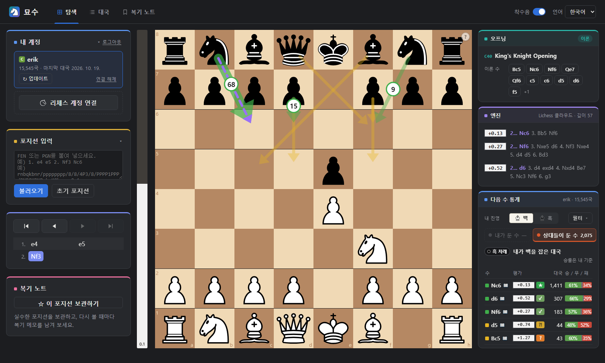
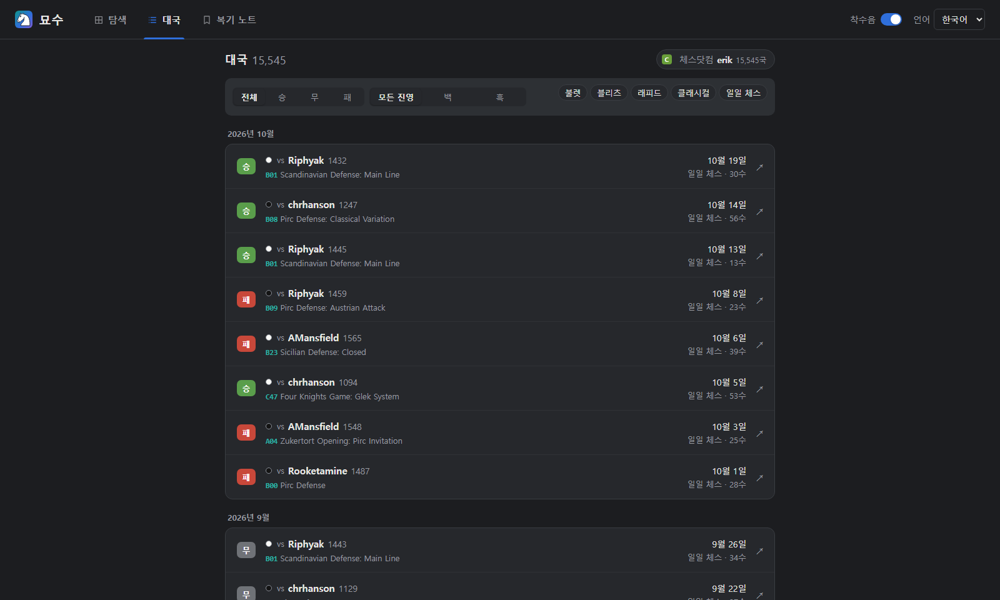
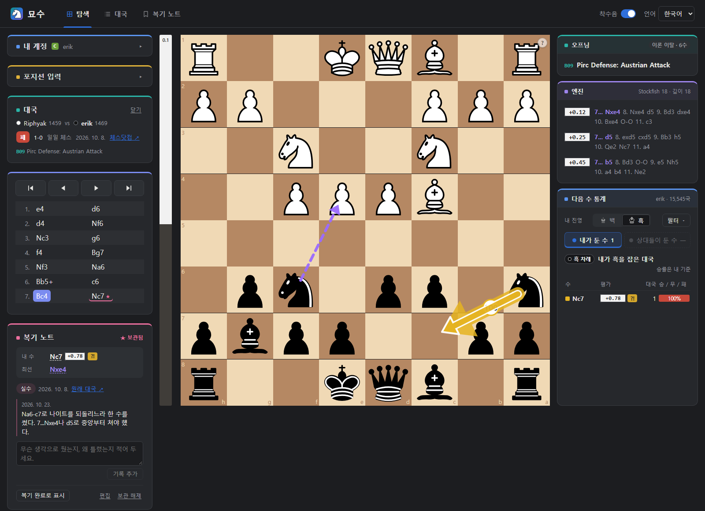
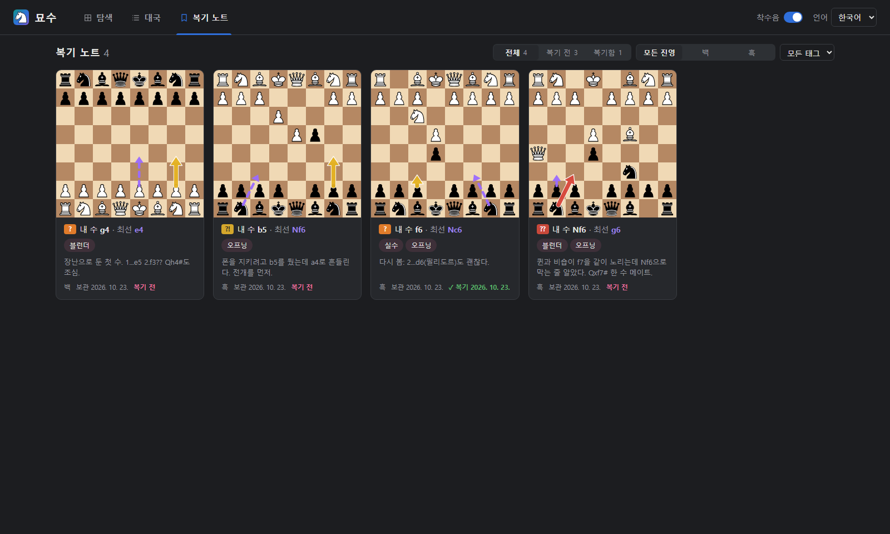

# 묘수 (Myosu)

**Myosu** is a personal chess review tool. It imports your games from Chess.com and Lichess and shows, for any position, which moves *you* and *your opponents* actually played — drawn as arrows on the board with win/draw/loss rates, engine evaluations and opening names. You can browse your recent games move by move and keep review notes on the positions where you went wrong.

체스닷컴·리체스 대국 기록으로 **"이 포지션에서 나는 주로 뭘 뒀고, 상대들은 뭘 뒀는지"**를 보드 위 화살표로 보여 주는 체스 복기 도구입니다. 최근 대국을 한 수씩 다시 보고, 실수한 포지션은 복기 노트로 모아 둘 수 있습니다.

**사이트:** https://myosu-chess.vercel.app



## 화면

### 탐색: 포지션별 수순 통계

위 화면입니다. 어떤 포지션이든(보드에서 직접 두기, FEN·PGN 붙여 넣기) 내 대국에서 다음에 나온 수를 보여 줍니다.

- **보드 위 화살표**: 자주 둔 수일수록 굵고, 숫자는 비율(%)입니다. 색은 엔진 판정이라 초록은 좋은 수, 노랑은 부정확·실수, 빨강은 블런더, 보라 점선은 엔진 최선 수입니다.
- **다음 수 통계**: 수마다 평가·판정, 대국 수, 승/무/패를 보여 줍니다. 내 차례면 "내가 둔 수", 상대 차례면 "상대들이 둔 수"가 열립니다. 수순이 달라도 같은 포지션이면 합쳐서 셉니다.
- **엔진**: 평가 막대와 엔진 후보 수 3개입니다. Lichess 클라우드 평가에 있으면 바로 쓰고, 없으면 브라우저 안의 Stockfish 18이 몇 초 안에 계산합니다.
- **오프닝**: ECO 코드와 이름, 이론으로 이어지는 다음 수를 보여 줍니다.
- **필터**: 내 진영(백/흑), 기간, 시간 규칙(불렛·블리츠·래피드·클래시컬·일일)으로 거릅니다.

### 대국: 최근 대국 목록



- 연결한 계정의 대국을 최근 순으로 달별로 묶어 보여 줍니다.
- 결과(승/무/패), 진영, 시간 규칙으로 거를 수 있습니다.
- 줄마다 상대와 레이팅, 오프닝, 날짜, 시간 규칙과 수 길이가 나오고, ↗로 원래 대국 페이지를 엽니다.

### 대국 복기



- 대국을 누르면 탐색 화면에서 그 대국을 엽니다. ← →로 한 수씩 넘기며 포지션마다 엔진 평가와 내 통계를 봅니다.
- 내 진영과 통계 계정은 그 대국에 맞춰 자동으로 바뀌고, "내 계정"·"포지션 입력" 패널은 접혀서 수순과 복기 노트 자리를 만듭니다.
- 실수한 장면에서 **"이 포지션 보관하기"**를 누르면 내 수를 두기 직전 포지션이 복기 노트로 저장됩니다.
  - 대국 주소·날짜는 자동으로 채워집니다.
  - 보드에는 내 수가 흰 테두리 화살표로, 최선 수가 보라 점선으로 표시됩니다.
  - 보관한 수는 수순 목록에 ★로 표시됩니다.

### 복기 노트



- 보관한 포지션을 작은 보드 카드로 모아 봅니다. 카드마다 내 수와 판정, 최선 수, 태그, 마지막 메모가 나옵니다.
- 복기 전/복기함, 진영, 태그로 거를 수 있습니다.
- 카드를 누르면 탐색 화면에서 그 포지션이 열립니다. 메모는 덮어쓰지 않고 날짜별로 쌓이고, 다시 보고 정리했으면 "복기 완료"로 표시합니다.
- 통계 표의 "내가 둔 수" 줄에서 ☆를 눌러 바로 보관할 수도 있습니다.

## 사용 흐름

1. **계정 연결**: "내 계정"에서 리체스 계정을 연결하면(OAuth) 대국을 자동으로 가져옵니다. 처음에는 최근 3년치, 이후 "업데이트"를 누르면 마지막 대국 이후의 새 대국만 받습니다. 체스닷컴 연결은 OAuth 승인을 기다리는 중입니다.
2. **탐색**: 자주 나오는 포지션에서 내가 뭘 두는지, 상대가 뭘 두는지, 그 수들이 엔진 기준으로 어땠는지 봅니다.
3. **대국 복기**: "대국" 탭에서 최근 대국을 열어 한 수씩 다시 봅니다.
4. **복기 노트**: 실수한 포지션을 보관하고 메모를 남긴 뒤, "복기 노트" 탭에서 모아 다시 봅니다.

**알아두실 점**
- 본인이 연결한 계정의 대국만 볼 수 있습니다.
- 키보드: ← → 한 수 이동, Home/End 처음/끝
- 착수음 켜기/끄기, 한국어/영어, 밝은/어두운 테마(시스템 설정을 따름)를 지원합니다.

## 구성

| | |
|---|---|
| 백엔드 | Python · FastAPI · SQLModel(SQLite / Postgres) · python-chess |
| 프론트엔드 | React · TypeScript · Vite · chess.js · react-chessboard · Stockfish.js(WebAssembly) |

```
backend/    FastAPI 앱 (수집기, 포지션 통계, 대국 목록, 복기 노트, 오프닝, 로그인)
frontend/   React 앱 (탐색 · 대국 · 복기 노트 화면, 브라우저 엔진)
scripts/    개발 서버 실행 스크립트 (dev.ps1)
docs/       README 스크린샷
```

설계와 데이터 흐름은 [CLAUDE.md](CLAUDE.md)에 자세히 정리되어 있습니다.

## 실행하기

필요한 것: Python 3.12+와 [uv](https://docs.astral.sh/uv/), Node.js 20+.

- 화면의 엔진 분석은 브라우저에서 돌아 Stockfish를 따로 설치하지 않아도 됩니다.
- 백엔드 API `/api/analysis/position`만 [Stockfish](https://stockfishchess.org/)를 씁니다. 없으면 그 API만 꺼집니다.

**Windows (한 번에 실행/종료)**

```
.\dev start     # 백엔드(:8000)와 프론트엔드(:5173)를 백그라운드로 실행
.\dev stop
.\dev status
.\dev logs
```

**직접 실행**

```bash
cd backend && uv sync && uv run uvicorn app.main:app --reload --port 8000
cd frontend && npm install && npm run dev      # http://localhost:5173
```

**테스트**

```bash
cd backend && uv run pytest
cd frontend && npm run typecheck
```

### 배포

| 역할 | 서비스 | 설정 |
|---|---|---|
| 화면 | Vercel | Root Directory `frontend`. `frontend/vercel.json`이 `/api/*`를 백엔드로 넘긴다 |
| 백엔드 | Render (Docker) | Root Directory `backend`, `backend/Dockerfile`. 상태 확인 `/api/health` |
| DB | Supabase Postgres | `DATABASE_URL`에 Session pooler 주소. Data API는 끈다 |

- 로컬 개발은 SQLite(`backend/data/chess.db`)를 씁니다.
- 운영 DB 주소는 배포 환경 변수에만 둡니다.
- 로컬 설정은 `backend/.env`(커밋하지 않음)에 적으면 읽습니다.

### 환경 변수 (모두 선택)

| 이름 | 설명 |
|---|---|
| `DATABASE_URL` | 기본 `backend/data/chess.db`. Postgres(`postgresql://...`)도 가능 |
| `IMPORT_HISTORY_YEARS` | 처음 가져올 기간(년), 기본 3 |
| `IMPORT_RATE_LIMIT_PER_HOUR` | IP당 시간당 새 가져오기 작업 수, 기본 20 (0이면 제한 없음) |
| `USER_AGENT_CONTACT` | 체스닷컴·리체스 API 요청에 붙일 연락처 |
| `PUBLIC_BASE_URL` | 앱 주소, OAuth 콜백에 사용. 기본 `http://localhost:5173` |
| `SECRET_KEY` | 세션 쿠키 서명 키. 없으면 `backend/data/secret_key`에 생성 |
| `LICHESS_CLIENT_ID` | 기본 `myosu` |
| `CHESSCOM_CLIENT_ID` / `CHESSCOM_CLIENT_SECRET` | 체스닷컴 OAuth 승인 후 설정 |
| `STOCKFISH_PATH` | 백엔드 엔진 API용. 비어 있으면 PATH에서 찾음 |
| `ENGINE_DEPTH` / `ENGINE_MULTIPV` / `ENGINE_THREADS` / `ENGINE_HASH_MB` | 백엔드 엔진 API 설정 (기본 18 / 3 / CPU 절반 / 128) |

## 데이터 출처

- 대국 데이터: [Chess.com Published-Data API](https://www.chess.com/news/view/published-data-api), [Lichess API](https://lichess.org/api)
- 엔진: [Stockfish.js](https://github.com/nmrugg/stockfish.js) 18 lite (GPL-3.0) — `frontend/public/engine/`
- 엔진 평가: [Lichess 클라우드 평가](https://lichess.org/api#tag/Analysis/operation/apiCloudEval)
- 오프닝 이름: [lichess-org/chess-openings](https://github.com/lichess-org/chess-openings) (CC0) — `backend/app/data/openings/`
- 착수음: [PyChess](https://github.com/pychess/pychess) (GPL-3.0-or-later) — `frontend/public/sounds/wood/LICENSE.txt`
- 기물 그림·아이콘: [react-chessboard](https://github.com/Clariity/react-chessboard)에 포함된 기물 SVG
- 리체스 로고: [lichess-org/lila](https://github.com/lichess-org/lila/tree/master/public/logo)의 `lichess-favicon.svg`(sadsnake1) 원본 — `frontend/public/brands/`
- 스크린샷의 대국: 체스닷컴 공개 계정 `erik`의 공개 대국

## 라이선스

Copyright (C) 2026 jinsub-kim-dev

이 프로그램은 [GNU Affero General Public License v3.0](LICENSE) 이상(AGPL-3.0-or-later)으로 배포합니다. 수정한 버전을 배포하거나 네트워크 서비스로 제공할 때는 같은 라이선스로 소스 코드를 공개해야 합니다.

함께 들어 있는 제3자 자료는 각자의 라이선스를 따릅니다: Stockfish.js(GPL-3.0, `frontend/public/engine/COPYING.txt`), 착수음(GPL-3.0-or-later, `frontend/public/sounds/wood/LICENSE.txt`), 오프닝 목록(CC0, `backend/app/data/openings/SOURCE.txt`). 리체스 로고는 lila의 라이선스 예외 항목으로 "lichess.org를 가리킬 때만" 쓸 수 있어 AGPL 대상이 아니며, 리체스 계정·연결 버튼 표시에만 씁니다(`frontend/public/brands/README.txt`).

Chess.com과 Lichess의 이름과 로고는 각 소유자의 상표입니다. 묘수는 두 서비스와 제휴하거나 보증받은 서비스가 아닙니다.
